# PRAKTIKUM JARKOM MODUL 3 KELOMPOK K18 - 2026

## Anggota Kelompok

| Nama                  | NRP        |
| --------------------- | ---------- |
| Catur Setyo Ragil     | 5027251066 |
| Senna Bagus Harimurti | 5027251106 |

## Ringkasan Implementasi

- Praktikum menggunakan `debinet` sebagai router/server dan `alpinet` sebagai client.
- Prefix IP kelompok: `192.220.x.x` - jaringan hasil pembagian: DMZ `192.220.1.0/24`, Divisi A (`Network 2`) `192.220.2.0/24`, Divisi B (`Network 3`) `192.220.3.0/24`, Data Center (`Network 4`) `192.220.4.0/24`. Domain internal: `k18.com`.
- Topologi terdiri dari 21 node docker + 10 Ethernet switch + 1 NAT.
- Semua script instalasi & konfigurasi diletakkan di `/root` tiap node dan diarsipkan pada folder `scripts/` repo ini.

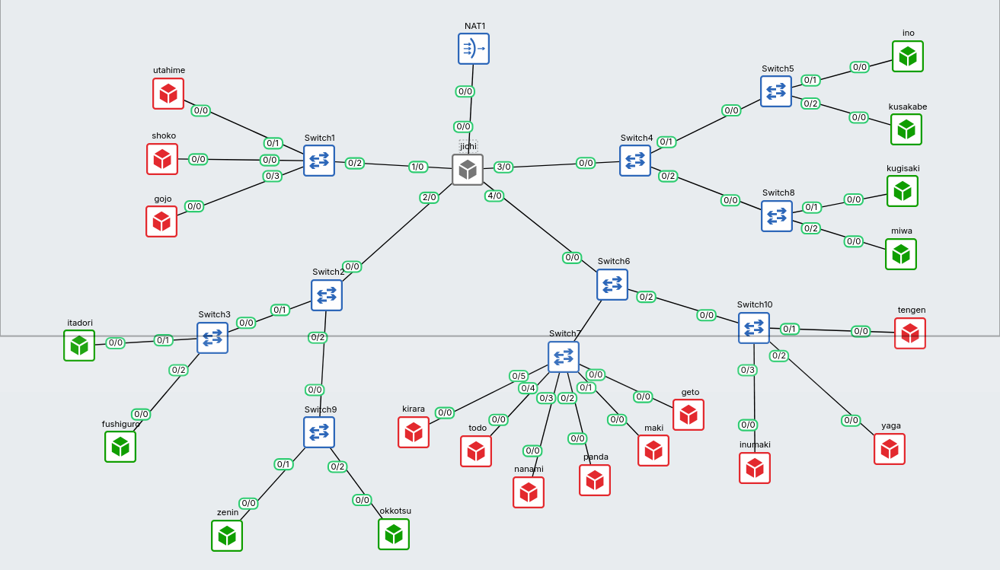

---

## Laporan

### Soal 1 - Konfigurasi NAT dan IP forwarding

Topologi: **jichi** sebagai router utama dengan 5 interface (`eth0` >> NAT, `eth1`–`eth4` >> masing-masing Network 1–4), DHCP server **tengen** di Data Center, 12 klien `alpine` terbagi ke Divisi A dan Divisi B, serta server jaringan (DNS, worker, LB, database) di DMZ dan Data Center.

**Konfigurasi** (`scripts/soal_1.sh`, diterapkan per node). jichi:

```text
auto eth0
iface eth0 inet dhcp        

auto eth1                   
iface eth1 inet static
  address 192.220.1.1
  netmask 255.255.255.0

auto eth2                   
iface eth2 inet static
  address 192.220.2.2
  netmask 255.255.255.0

auto eth3                   
iface eth3 inet static
  address 192.220.3.1
  netmask 255.255.255.0

auto eth4                   
iface eth4 inet static
  address 192.220.4.1
  netmask 255.255.255.0
```

NAT + forwarding di `jichi`:

```sh
echo 1 > /proc/sys/net/ipv4/ip_forward
iptables -t nat -C POSTROUTING -o eth0 -s 192.220.0.0/16 -j MASQUERADE || \
  iptables -t nat -A POSTROUTING -o eth0 -s 192.220.0.0/16 -j MASQUERADE
```

`init.sh` tahap persiapan awal agar node dapat mengunduh paket yang dibutuhkan

```sh
echo 'nameserver 192.168.122.1' > /etc/resolv.conf
```

| Host | IP | Gateway |
|---|---|---|
| jichi | `.1.1` / `.2.2` / `.3.1` / `.4.1` (+ eth0 DHCP) | - |
| utahime | 192.220.1.2/24 | 192.220.1.1 |
| shoko | 192.220.1.3/24 | 192.220.1.1 |
| gojo | 192.220.1.4/24 | 192.220.1.1 |
| itadori / fushiguro / zenin / okkotsu | IP sementara `.2.36–.39` (later DHCP) | 192.220.2.2 |
| ino / kusakabe / miwa / kugisaki | IP sementara `.3.90–.93` (later DHCP) | 192.220.3.1 |
| geto / maki / panda / nanami / todo / kirara | `.4.2 – .4.7` | 192.220.4.1 |
| yaga / inumaki | `.4.8` / `.4.9` | 192.220.4.1 |
| tengen | 192.220.4.10/24 | 192.220.4.1 |

Klien awal diberi IP statis sementara **di luar** semua pool DHCP (Divisi A `.2.36–.39`, Divisi B `.3.90–.93`) hanya untuk persiapan instalasi paket.

**Validasi:** `ip a` dan `ip route` tiap host (harus ada `default via ...`), ping gateway dari tiap host, ping internet (`ping google.com`), dan `iptables -t nat -L -v` di jichi.

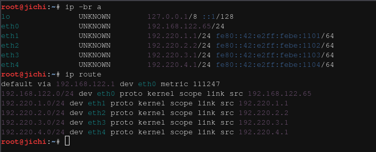

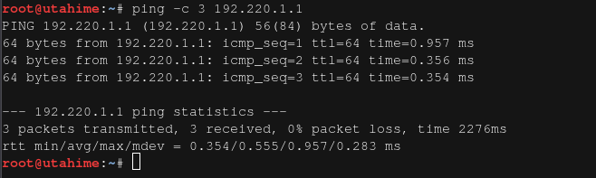

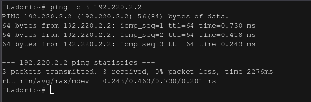

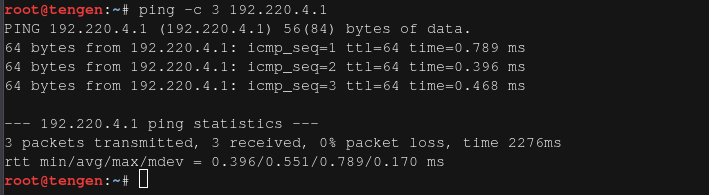

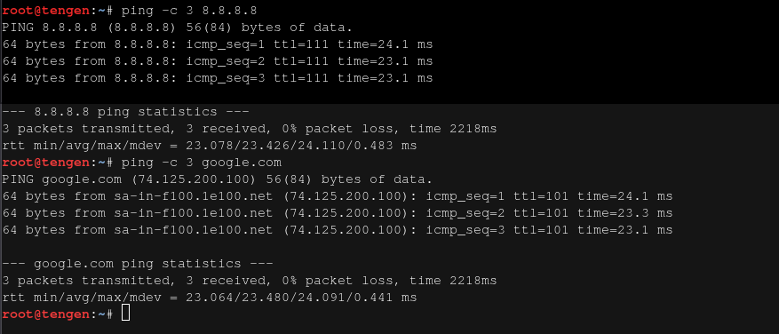

---

### Soal 2 - DHCP Server di tengen

**Konfigurasi** (`scripts/soal_2.sh`, di tengen): instal `isc-dhcp-server`, `INTERFACESv4="eth0"` di `/etc/default/isc-dhcp-server`, lalu `dhcpd.conf`. Network 4 dideklarasikan sebagai subnet lokal **tanpa pool** (mencegah error *No subnet declaration* karena dhcpd berada di subnet tersebut):

```
authoritative;
option domain-name-servers 192.168.122.1;   

# Network 4 - subnet lokal tanpa pool dinamis
subnet 192.220.4.0 netmask 255.255.255.0 { }

# Network 2 (Divisi A)
subnet 192.220.2.0 netmask 255.255.255.0 {
  option routers 192.220.2.2;
  option broadcast-address 192.220.2.255;
  pool { range 192.220.2.10 192.220.2.34; }
  pool { range 192.220.2.70 192.220.2.94; }
}

# Network 3 (Divisi B)
subnet 192.220.3.0 netmask 255.255.255.0 {
  option routers 192.220.3.1;
  option broadcast-address 192.220.3.255;
  pool { range 192.220.3.10 192.220.3.88; }
  pool { range 192.220.3.100 192.220.3.199; }
}
```

Rentang terlarang Divisi A (`192.220.2.36–192.220.2.69`) sengaja tidak dimasukkan ke range mana pun.

**Validasi:** `dhcpd -t` valid, `service isc-dhcp-server status` berjalan tanpa error, lease tercatat di `/var/lib/dhcp/dhcpd.leases`.

```sh
dhcpd -t -cf /etc/dhcp/dhcpd.conf 2>&1; true
service isc-dhcp-server status; true
ps aux | grep dhcpd | grep -v grep; true
ss -uln | grep :67; true
grep -E "subnet|pool|range|class|host" /etc/dhcp/dhcpd.conf; true
```

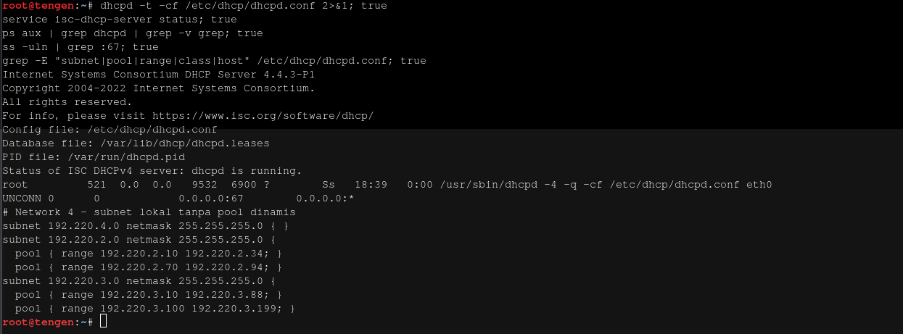

---

### Soal 3 - DHCP Relay di jichi

**Konfigurasi** (`scripts/soal_3.sh`, di jichi):

```text
# /etc/default/isc-dhcp-relay
SERVERS="192.220.4.10"
INTERFACES="eth2 eth3 eth4"
```

Kedelapan klien Divisi A & B diganti ke `iface eth0 inet dhcp` lalu di-restart.

Temuan penting: `INTERFACES` relay **harus mencakup eth4** - balasan OFFER/ACK dari tengen ter-routing masuk ke jichi lewat eth4, sedangkan `dhcrelay` hanya memproses paket yang *ingress* di interface terdaftar. Hal ini dibuktikan lewat tcpdump: DISCOVER klien sampai ke tengen dan OFFER dikirim ke giaddr `.2.2`/`.3.1`, namun klien tidak pernah menerimanya sebelum eth4 ditambahkan.

**Validasi:** `ps aux | grep dhcrelay` (proses `dhcrelay -q -i eth2 -i eth3 -i eth4 192.220.4.10`), klien memperoleh IP dari pool yang benar, dan lease aktif per-MAC tercatat di `dhcpd.leases` tengen.

di jichi:
```sh
cat /etc/default/isc-dhcp-relay
ps aux | grep dhcrelay | grep -v grep
pgrep -a dhcrelay; true
```

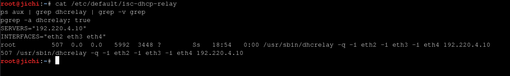

di tengen:
```sh
sh /root/soal_4.sh
sh /root/soal_5.sh
sh /root/soal_6.sh
grep -E "class|subclass|allow|host|fixed|domain" /etc/dhcp/dhcpd.conf; true
```

lalu di itadori:
```sh
ifdown eth0 2>&1; ifup eth0
ip -4 addr show dev eth0
cat /etc/resolv.conf
ping -c 3 192.220.2.2
```

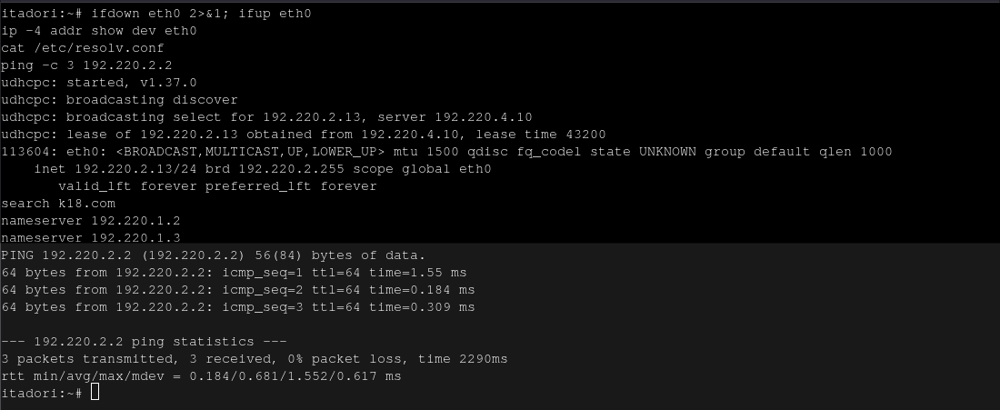

---

### Soal 4 - Dua Pool Berbasis Class MAC di Divisi A

Pool 1 (`192.220.2.10–.34`, itadori & fushiguro) dan Pool 2 (`192.220.2.70–.94`, zenin & okkotsu) berada di subnet yang sama, sehingga pemisahannya memakai **class MAC address** (`subclass` 1:**MAC**), bukan subnet.

**Konfigurasi** (`scripts/soal_4.sh`, di tengen):

```
class "pool1" { match pick-first-value (option dhcp-client-identifier, hardware); }
subclass "pool1" 1:02:42:8d:c6:9a:00;      # itadori
subclass "pool1" 1:02:42:ea:a1:6f:00;      # fushiguro

class "pool2" { match pick-first-value (option dhcp-client-identifier, hardware); }
subclass "pool2" 1:02:42:ac:3e:97:00;      # zenin
subclass "pool2" 1:02:42:d2:43:1c:00;      # okkotsu

subnet 192.220.2.0 netmask 255.255.255.0 {
  pool { range 192.220.2.10 192.220.2.34; allow members of "pool1"; }
  pool { range 192.220.2.70 192.220.2.94; allow members of "pool2"; }
}
```

**Validasi:** after restart, itadori>>`.2.10` & fushiguro>>`.2.11` (Pool 1), zenin>>`.2.70` & okkotsu>>`.2.71` (Pool 2 - terbukti pindah pool dari alokasi awal saat class aktif); tidak ada klien mendapat IP di `.2.36–.2.69`.

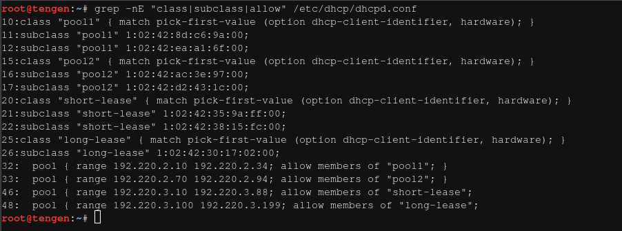

---

### Soal 5 - Short/Long Lease & Opsi DNS di Divisi B

**Konfigurasi** (`scripts/soal_5.sh`, di tengen): class `short-lease` (ino, kusakabe) >> pool `.3.10–.3.88` dengan `default/max-lease-time 1800`; class `long-lease` (miwa) >> pool `.3.100–.3.199` dengan lease `43200`. Opsi DHCP global diganti ke DNS internal sesuai soal:

```
option domain-name-servers 192.220.1.2, 192.220.1.3;
option domain-name "k18.com";
option domain-search "k18.com";
```

`allow members of` diterapkan pada kedua pool Divisi B sehingga hanya anggota class yang dilayani pool-nya (kugisaki belum punya class dan sengaja belum di-restart - fixed-address-nya menyusul di Soal 6).

**Validasi:** lease time terbaca langsung di output `udhcpc` saat renew klien (`lease of 192.220.3.10 obtained, lease time 1800` dsb.); ino/kusakabe `.3.10`/`.3.11` dengan 1800s, miwa pindah ke `.3.100` dengan 43200s; `resolv.conf` klien berisi kedua DNS + `search k18.com`.

di ino dan miwa
```sh
ifdown eth0 2>&1; sleep 2; ifup eth0
```

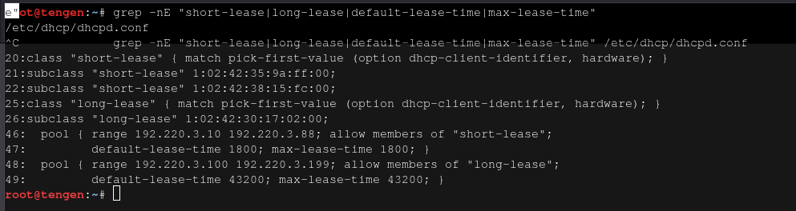

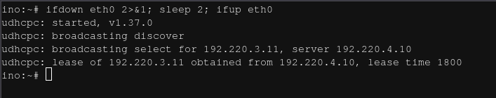

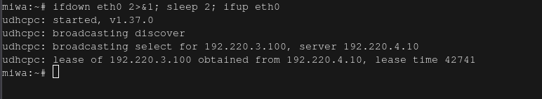

pada ino
```sh
cat /etc/resolv.conf
ip -4 addr show dev eth0
ip route
ping -c 3 192.220.3.1
```

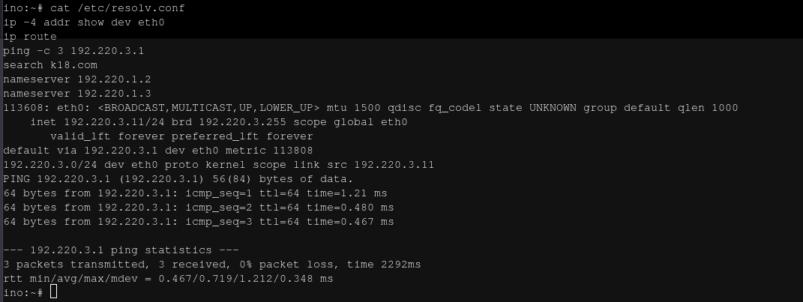

---

### Soal 6 - Fixed Address kugisaki

**Konfigurasi** (`scripts/soal_6.sh`, di tengen): blok `host` berdasarkan MAC, di luar semua pool dinamis:

```
host kugisaki {
  hardware ethernet 02:42:99:23:7c:00;
  fixed-address 192.220.3.99;
}
```

**Validasi:** kugisaki konsisten mendapat `192.220.3.99` setelah restart node **dan** setelah renew (`ifdown/ifup`); gateway `.3.1` dan opsi DNS/domain tetap benar. Catatan menarik yang terkonfirmasi: `.3.99` **tidak** muncul di `dhcpd.leases` - fixed-address di luar pool adalah binding statik dari deklarasi host, bukan lease dinamis.

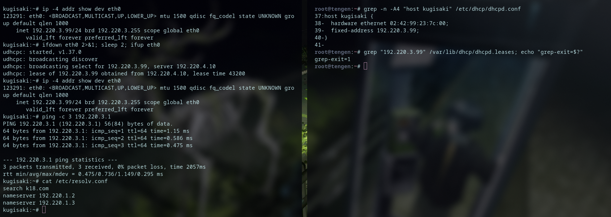

---

### Soal 7 - Audit Menyeluruh Klien

Tidak ada perubahan konfigurasi; lease kedelapan klien hanya di-renew (`ifdown/ifup`) agar opsi DNS internal berlaku di semua klien, lalu seluruh klien Divisi A & B diaudit: mask `/24`, broadcast benar, gateway benar, DNS ganda `.1.2`+`.1.3`, domain-search `k18.com`, IP sesuai pool/fixed-address, tidak ada klien di rentang terlarang, dan semuanya cocok dengan `dhcpd.leases` di tengen (IP + durasi lease per class).

Hasil audit:

| Node | IP | Pool | Gateway | Lease |
|---|---|---|---|---|
| itadori | 192.220.2.10 | pool1 | 192.220.2.2 | 43200s |
| fushiguro | 192.220.2.11 | pool1 | 192.220.2.2 | 43200s |
| zenin | 192.220.2.70 | pool2 | 192.220.2.2 | 43200s |
| okkotsu | 192.220.2.71 | pool2 | 192.220.2.2 | 43200s |
| ino | 192.220.3.10 | short-lease | 192.220.3.1 | 1800s |
| kusakabe | 192.220.3.11 | short-lease | 192.220.3.1 | 1800s |
| miwa | 192.220.3.100 | long-lease | 192.220.3.1 | 43200s |
| kugisaki | 192.220.3.99 | fixed (host) | 192.220.3.1 | statis |

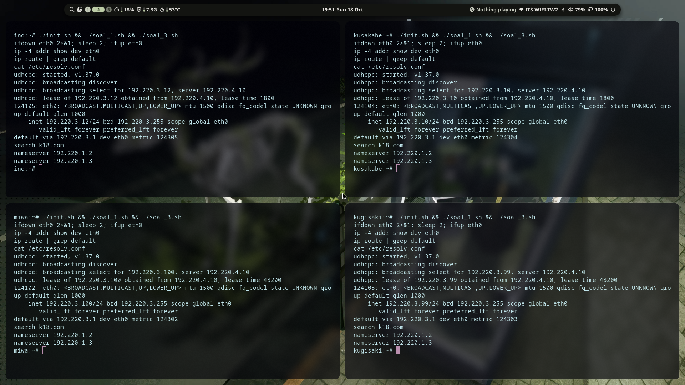

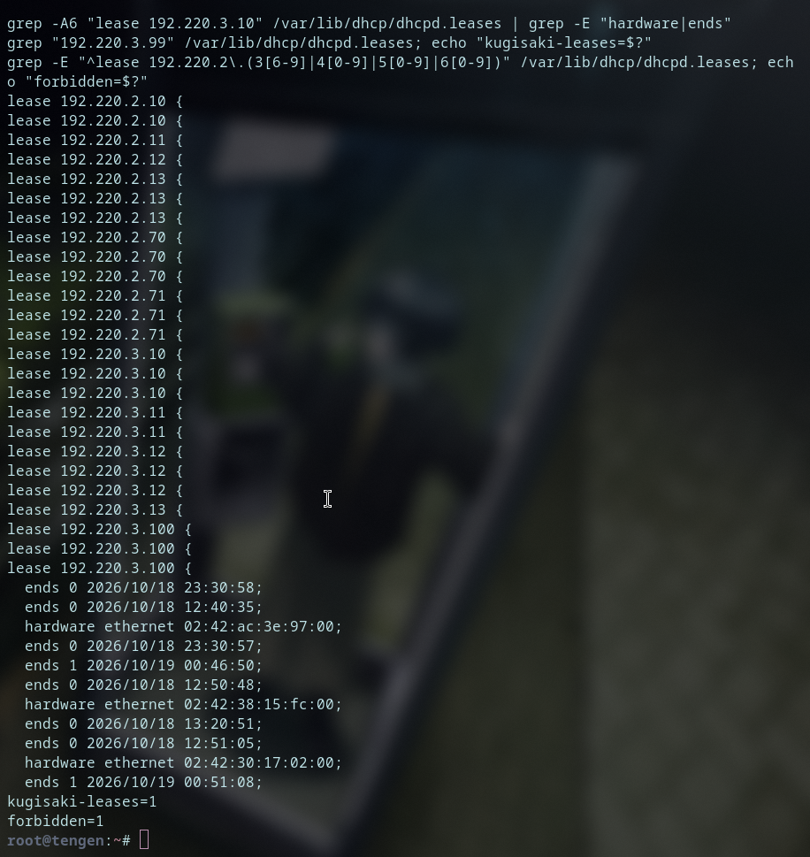

---

### Soal 8 - Bukti DORA melalui Packet Capture

`tcpdump -i eth0 -n -vv` di tengen disiapkan (window 90 detik, file dibaca setelah tcpdump exit agar buffer ter-flush), lalu renew dipicu pada dua klien - satu per subnet: itadori (Divisi A) dan ino (Divisi B).

Result per client:

- urutan DORA lengkap: DISCOVER >> OFFER >> REQUEST >> ACK;
- **giaddr** semua paket = IP jichi pada subnet klien (`.2.2` untuk Divisi A, `.3.1` untuk Divisi B) - bukti jalur relay;
- Server-ID `192.220.4.10`, Your-IP = IP klien sesuai pool-nya, Lease-Time 43200/1800 sesuai class;
- jalur relay terlihat: DISCOVER/REQUEST `192.220.4.1 >> 192.220.4.10`, OFFER/ACK `192.220.4.10 >> giaddr`.


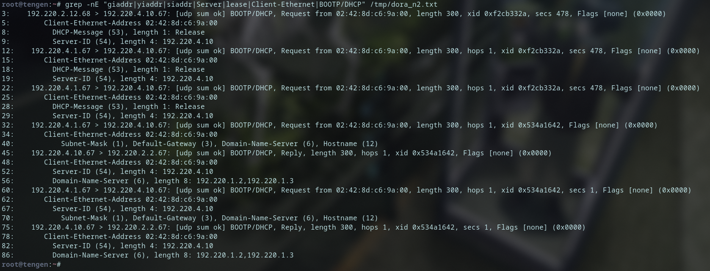

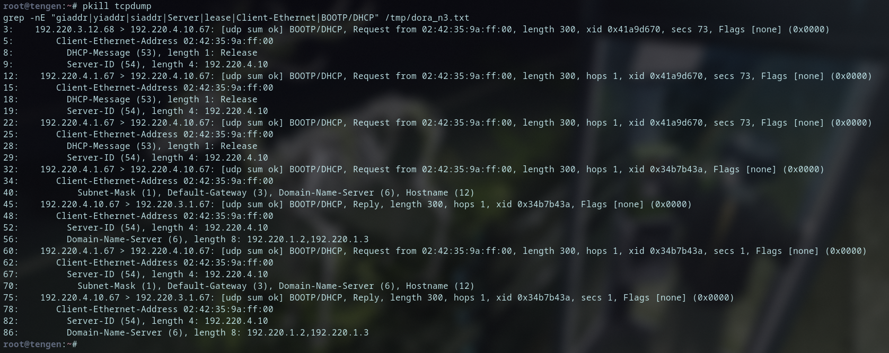

---

### Soal 9 - Simulasi Gangguan DHCP Relay

Jalankan `scripts/soal_9.sh` pada itadori:

1. **PRE** - relay hidup, itadori `192.220.2.10` OK.
2. **GANGGUAN** - `service isc-dhcp-relay stop` di jichi >> renew klien berakhir `udhcpc failed to get a DHCP lease` (timeout tanpa OFFER), eth0 tanpa IPv4, ping gateway `.2.2` gagal.
3. **PULIH** - `service isc-dhcp-relay start` >> renew sukses, IP kembali `192.220.2.10` (terikat MAC), gateway semula OK.

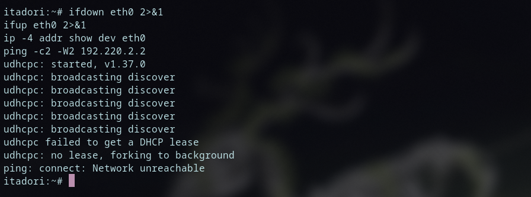

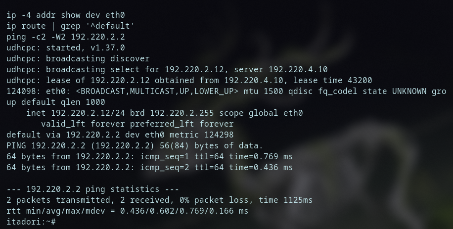

---

### Soal 10 - Persistensi Layanan

Autostart DHCP Server (tengen) dan DHCP Relay (jichi) dipasang melalui `/root/init.sh` yang dijalankan otomatis saat boot (`scripts/soal_10.sh`). Karena pengamatan: init-script `isc-dhcp-relay` Debian **tidak mengimplementasikan `status` sungguhan** (selalu exit 0 walau daemon mati), sehingga autostart relay memakai start tanpa syarat + polling verifikasi `pgrep`.

```sh
# /root/init.sh tengen - tunggu interface dapat IP dulu (dhcpd butuh interface utk listen)
n=0
while [ $n -lt 15 ] && ! ip -4 addr show eth0 | grep -q inet; do sleep 1; n=$((n+1)); done
service isc-dhcp-server status >/dev/null 2>&1 || service isc-dhcp-server start
```

```sh
# /root/init.sh jichi - forwarding + MASQUERADE + DNS + autostart relay
# (init.sh lengkap juga memuat net.ipv4.ip_forward=1, rule MASQUERADE idempoten,
#  dan resolv.conf - lihat scripts/soal_10.sh)
while [ $n -lt 15 ] && ! ip -4 addr show eth2 | grep -q inet; do sleep 1; n=$((n+1)); done
service isc-dhcp-relay start        # start tanpa syarat - guard status relay menipu
```

**Validasi:** kedua node di-restart penuh (stop>>start) >> dhcpd & dhcrelay hidup sendiri; config jichi utuh (5 IP, forwarding, MASQUERADE di-reapply); kebijakan dhcpd.conf utuh; kedelapan klien tidak terpengaruh (IP/gateway/ping + konektivitas lintas subnet itadori>>tengen); renew pembuktian: itadori `.2.10` (pool1), ino lease 1800s, kugisaki `.3.99` (fixed).

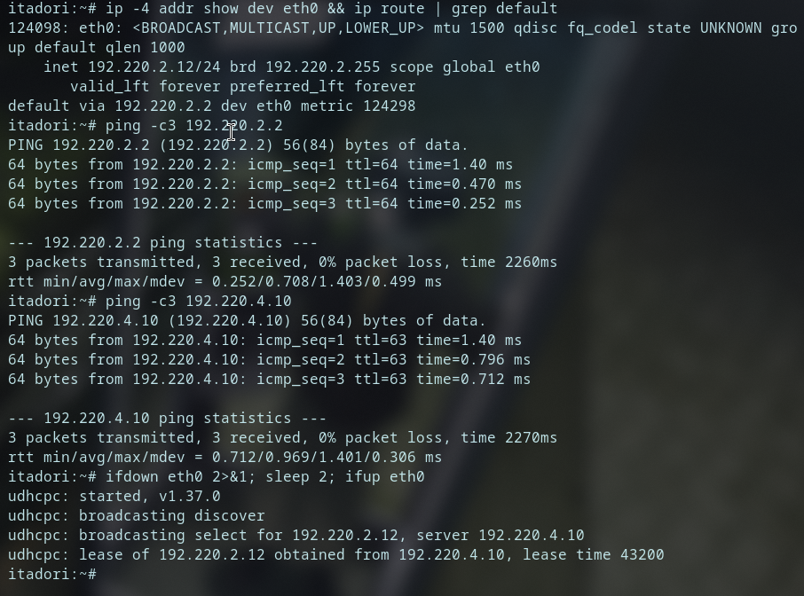

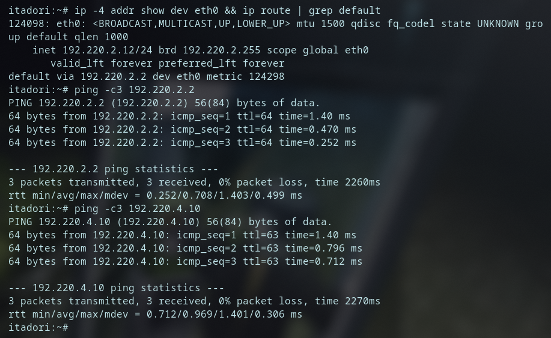

---

